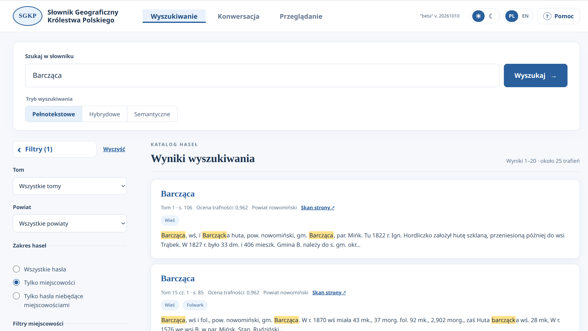
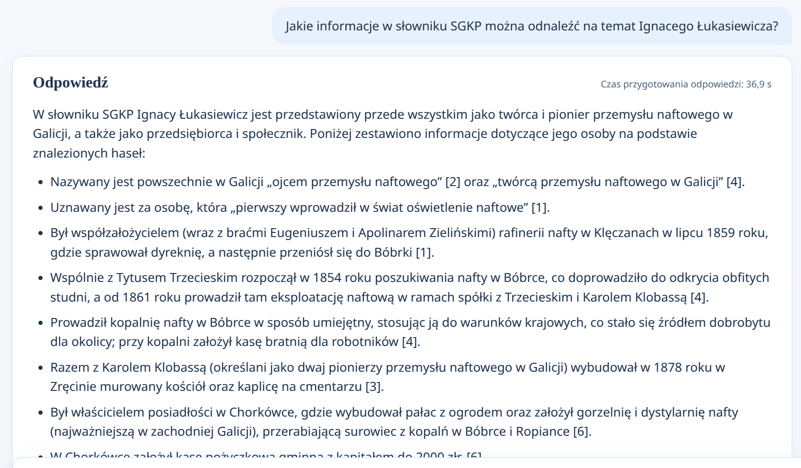
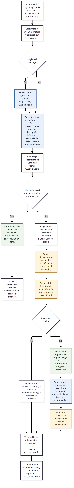

# Wyszukiwarka SGKP

Aplikacja Flask / Meilisearch. Służy do wyszukiwania pełnotekstowego, semantycznego i konwersacyjnego w Słowniku Geograficznym Królestwa Polskiego.
Przygotowana z udziałem Codex.


## Uruchomienie

Wymagane: Python 3.11+, Meilisearch 1.54, katalog `json/` z 16 tomami SGKP zapisanymi w formacie JSON.
Model do konwersacji: `qwen3.8-flash-next-fp8`
Model embeddings: `jina-embeddings-v3`

Import tekstowy:

```bash
venv/bin/python -m sgkp_search.ingest --suffix test_tekst
```

Import z embeddingami Jina (1024 wymiary):

```bash
venv/bin/python -m sgkp_search.ingest --suffix test_jina --with-vectors
```

Uruchomienie aplikacji:

```bash
venv/bin/python app.py
```


## Opis 

Interfejs ma trzy zakładki: **Wyszukiwanie** z wynikami, **Konwersacja** z odpowiedziami opartymi na cytowanych hasłach oraz **Przeglądanie** gdzie można ręcznie przeglądać hasła słownika. Opis aplikacji i wskazówki znajdują się w oknie **Pomoc** w nagłówku. W obu widokach dostępny jest ten sam zestaw filtrów. Po wybraniu „Tylko miejscowości” odblokowują się pola: „Tylko Królestwo Polskie”, typ miejscowości, gubernia i gmina. Gminę wybiera się z listy po wpisaniu fragmentu nazwy. 

Pełniejszy opis aplikacji na stronie: <a href="https://ai.ihpan.edu.pl/pl/narzedzia/sgkp-search/" target="_blank">SGKP-Search</a>

Wyszukiwanie pełnotekstowe:



Konwersacja:



Diagram obsługi pytania użytkownika: 

Niebieskie pola oznaczają pracę modelu językowego, zielone — operacje na
danych, a żółte — dobór źródeł i czynności zależne od ustawień lub wyniku
poprzednich etapów. Błędy walidacji i niedostępność usług mogą zakończyć
przetwarzanie na wcześniejszych etapach.


